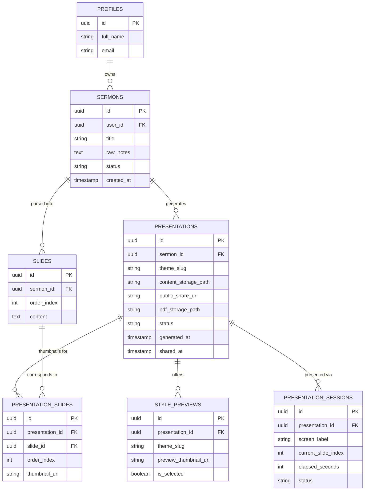

# AutoSlides — Database Schema v3 (ER Diagram)

> Final version: the generated slideshow is technically an HTML file under the hood, but
> it's never exposed to the user as a "file." Users just see slides living inside your app
> — View renders it embedded, Present renders it fullscreen with your own control panel.
> A public share link (Vercel) is optional, not the primary way users interact with it.
>
> Preview with VS Code's **"Markdown Preview Mermaid Support"** extension.

---

## Plain-English walkthrough of each box

- **PROFILES** — who's logged in. Just your basic account info.

- **SERMONS** — created the moment you paste your preaching notes. Stores the raw text and
  whose account it belongs to. Nothing is split into slides yet at this stage.

- **SLIDES** — the result of applying your blank-line separation rule to the raw notes. Each
  row is one slide's worth of text. This is what powers your preview screen so you can
  confirm the split is correct before generating anything.

- **PRESENTATIONS** — created only once you click Generate. This is the "finished, styled"
  version. `content_storage_path` is where the generated file actually lives (invisible to
  the user — they never see this), `public_share_url` is the optional Vercel link if you
  want a shareable version outside your app, and `pdf_storage_path` is only filled in if the
  user explicitly exports to PDF. `status` (not_generated / previewing_styles / generating /
  generated) is what decides whether your list screen shows Generate or View for a given
  item.

- **STYLE_PREVIEWS** — the 3 style options shown before final generation (a safe preset, a
  bold template, a wildcard). `is_selected` marks which one the user picked. Kept around
  mainly for a record of what was offered, in case you want a "change style" feature later.

- **PRESENTATION_SLIDES** — powers the filmstrip/carousel in your custom Present-mode
  control panel. Just a thumbnail image per slide plus its order, tied back to the original
  `SLIDES` row for reference.

- **PRESENTATION_SESSIONS** — tracks live presenting state: which slide you're currently on,
  elapsed time, which screen it's showing on. Synced in real time so a laptop control panel
  and a projector display stay in step.